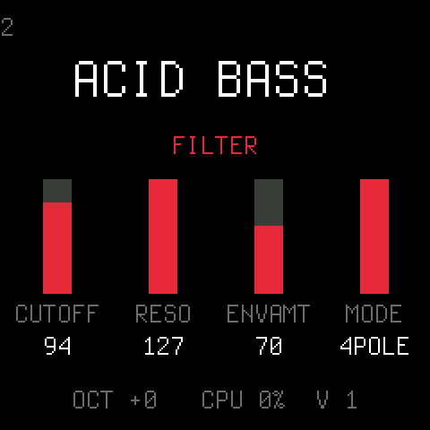

# fm1-hv

**A Virus-inspired synthesizer for the M-VAVE FM-1.** Not an emulation: a homage. Two classic oscillators with
spectral waves, a sub, noise and ring modulation; two filters with Virus-style routing and saturation; the
filter and amp envelopes with sustain slope; two LFOs; unison; chorus and delay. The patch format is the classic
Virus single, so Virus A/B/C singles load and play as reasonable approximations.

<p align="center"></p>

> **Status: 0.0, early development.** The engine runs on the host (WAV renders) and the firmware builds on GitHub.
> It has not yet run on an FM-1. Do not install it on a unit you depend on.

## Playing it

| Control | Does |
| --- | --- |
| Keys, OCT- / OCT+ | play; the octave |
| PRESETS | the patch |
| SELECT | the edit page: OSC, OSC MOD, MIX, FILTER, FILTER 2, FILT ENV, AMP ENV, LFO 1, LFO 2, CHORUS, DELAY, UNISON |
| ENV / LFO / FX | jump to the envelope, LFO and effect pages (press again for the second one) |
| K1 .. K4 | the page's four parameters |
| MIDI in (USB, TRS) | notes; CC 17..119 set the Virus page-A parameter of the same number, as on a Virus |

The status line shows the audio interrupt's load (of its 5.8 ms) and the voices sounding.

## Building

The firmware builds with the JieLi toolchain on Linux x86-64 (or in Docker); see [docs/DINGHY-README.md](docs/DINGHY-README.md).
GitHub builds it on every push to `main` (Actions → *release* → the `fm1-hv-fwsc` artifact) and also uploads the host
renders (`fm1-hv-host-renders`: demo WAVs and screens).

Without the toolchain, on any computer with a C compiler:

```sh
cc -O2 -o build/hv_render tools/hv/hv_render.c firmware/src/hv/hv_engine.c && build/hv_render build   # demo WAVs
sh tests/run_host.sh tests/hv_demo.txt                                                             # the app: WAV + screens
```

## Plan

[docs/ARCHITECTURE.md](docs/ARCHITECTURE.md): the engine, the CPU and memory budget, the phases.

## Credits

fm1-hv by Brian McCalla. Built on [Dinghy](https://github.com/zvenson/dinghy) (zvenson), on the platform of
[Felucca](https://github.com/hugelton/Felucca) (Leo Kuroshita, Hügelton Instruments) as [SLOOP](https://github.com/isod89/sloop-fm1)
(isod89) carries it. Tested with Joakim Eriksson's [fm1-emu](https://github.com/joakimeriksson/fm1-emu). See
[LICENSING.md](LICENSING.md). Not affiliated with Access Music or M-VAVE; "Virus" is a trademark of its owner.
